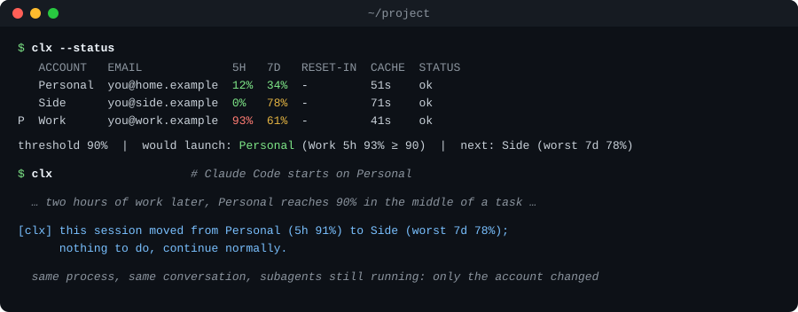
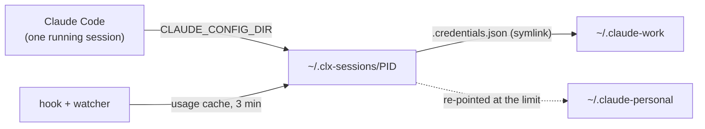

# clx

**Use several Claude Code accounts as one.** `clx` starts Claude Code on whichever of your accounts has the most room left. When that account reaches its usage limit in the middle of a task, clx moves the *running* session to your next account. You don't restart, don't run `/login`, and don't lose your conversation or running subagents.

[](https://github.com/KrasimirKralev/clx/actions/workflows/test.yml)
[](LICENSE)


<p align="center">
  
</p>

> Unofficial; not affiliated with Anthropic. Read [Use it within Anthropic's terms](#use-it-within-anthropics-terms) before you start.

## Why

Claude Pro and Max plans have a 5-hour limit and a weekly limit. If you have more than one subscription (say a personal plan and a work plan), switching by hand means stopping, running `/logout` and `/login`, and starting again. Usually that happens right when you're deep in a task.

clx takes care of it:

- **Picks the account at launch.** `clx` starts on the account with the most room on every window the server reports: the 5-hour, weekly and per-model limits.
- **Moves a running session.** When the account reaches your threshold (90% by default), clx re-points the same session to the next account. The process, the conversation, background tasks and subagents carry on.
- **One shared setup.** Every account sees the same `settings.json`, `CLAUDE.md`, skills, agents, plugins, hooks and project history.
- **Plain and inspectable.** One Python file with no dependencies, a bash hook and an installer. Everything it writes is listed in [SECURITY.md](SECURITY.md). `--uninstall` removes the programs and the hook.

## Quick start

You need Linux, Python 3 and [Claude Code](https://claude.com/claude-code) logged in at least once.

```bash
curl -fsSL https://github.com/KrasimirKralev/clx/releases/latest/download/clx.tar.gz | tar xz
./clx/install.sh              # add --alias to make a plain `claude` go through clx

cm-login work you@work.example    # log a second account into ~/.claude-work
clx --status                      # every account, its usage, and which one clx would pick
clx                               # start Claude Code on the account with the most room
```

The installer also runs `clx --init`. That links your shared settings into every `~/.claude-*` dir, and anything it replaces is kept as `*.pre-clx`. Your existing `~/.claude` login counts as an account. Every other `clx` argument goes straight to `claude`, so `clx -c`, `clx -p "…"` and `clx --model …` work as usual.

## How it works

Claude Code keeps each login in a config dir (`CLAUDE_CONFIG_DIR`). It reads that dir's `.credentials.json` again on every request. clx builds on that:



1. **One dir per account.** Each account lives in `~/.claude-<name>`.
2. **One session dir per run.** `clx` starts each interactive session in its own dir, `~/.clx-sessions/<pid>`. That dir's `.credentials.json` is a symlink into one account's dir.
3. **A hook checks usage.** `cc-handoff.sh` runs on each prompt, at the end of each turn, and after tool calls (at most one real check every 20 s). It compares usage with your threshold. It reads a local cache and never waits on the network.
4. **The session moves at the threshold.** clx re-points the symlink to the account with the most room. The next request goes out on that account. The session shows one line saying it moved.
5. **Idle sessions are covered too.** A small watcher per session makes the same check every 30 s. That covers a session that is waiting on background agents and so sends no hook events. When Claude Code refreshes a token, the watcher copies the new login back into the account's own dir.

## Commands

| Command | What it does |
|---|---|
| `clx` | Start Claude Code on the account with the most room. |
| `clx --status` | Every account: usage per window, refill time, login state, live sessions. |
| `clx --use <name>` | Start on that account, whatever its usage. |
| `clx --sync` | Fetch usage for every account now, instead of using the 3-minute cache. |
| `clx --pause <name> [--days N \| --until YYYY-MM-DD \| --until never]` | Park an account. clx never starts on it and moves sessions off it. |
| `clx --resume <name>` | Put a parked account back in service (inside a session, use `--unpause`). |
| `clx --init` | Link your shared settings, `CLAUDE.md`, skills, agents, plugins, hooks and project history into every `~/.claude-*` dir. Anything it replaces is kept as `*.pre-clx`. |
| `clx-move <name>` | Move every running clx session to one account now. |
| `cm-login <name> [email]` | Log an account into `~/.claude-<name>`. If your browser is already signed in to another account, open the link in a private window. |
| `cm-login status` | Who is logged in to which dir. |
| `clx-openclaw setup` / `status` / `doctor` / `remove` | Run an OpenClaw gateway's Claude CLI turns through clx. See [OpenClaw agents](#openclaw-agents). |

### Settings

`~/.claude/cc.json` (optional):

```json
{ "threshold": 90, "primary": "work" }
```

- `threshold`: the usage % at which a session moves on.
- `primary`: the account to prefer while it is under the threshold. With no primary, clx starts on the account with the most room.

`CC_THRESHOLD` and `CC_PRIMARY` override them for one run. `CLX_NO_NOTIFY=1` turns off the desktop popup a move shows. `CLX_NO_FAIL_SCAN=1` stops the watcher from reading failed turns out of the transcript.

When a caller hands Claude Code a token on a file descriptor (`CLAUDE_CODE_OAUTH_TOKEN_FILE_DESCRIPTOR`), that token beats every login clx could choose. By default, clx then steps aside and runs the CLI on the caller's choice. With `CLX_DROP_INJECTED_TOKEN=1`, clx chooses the account itself and removes that variable before it starts the CLI.

## OpenClaw agents

An OpenClaw gateway can run its agents' turns through Claude Code, with the Claude CLI backend. `clx-openclaw` puts clx on that route. Each CLI session the gateway starts then runs on the account with the most room. When a turn fails on a usage limit or a refused login, the session moves to another account and the next turn answers there.

```bash
clx-openclaw setup --with-skill   # write the shim and the gateway's drop-in; it restarts nothing
systemctl --user daemon-reload && systemctl --user restart openclaw-gateway.service   # setup prints this line
clx-openclaw doctor               # names every problem; `clx-openclaw status` shows sessions and moves
```

How it gets there:

- **The route.** OpenClaw's Claude CLI backend starts the first `claude` on the gateway's PATH. `setup` makes a small shim that `claude`.
  - If a directory of yours comes before every other `claude` on that PATH, `setup` puts a `claude` link to the shim there. Your shells and cron jobs that use that directory then go through clx too.
  - Otherwise, or with `--no-link`, a systemd user drop-in sets the unit's PATH with the shim's directory first. It sets the same value in an environment file of clx's. systemd reads that file after every `Environment=` line, so it wins wherever the unit sets its own PATH.
  - It never replaces a real `claude`.
  - The drop-in also sets `CLAUDE_CODE_EXECUTABLE` to the shim, for launches through the Agent SDK or an ACP adapter.
  - This route was verified with OpenClaw 2026.11.3 only.
- **The shim.** It runs clx with `CLX_DROP_INJECTED_TOKEN=1`, so clx picks the login instead of a token the gateway forwards. A launch with no terminal also gets `CLX_NO_NOTIFY=1`; a person whose shell finds the link keeps clx's notices. A caller that hands over `CLAUDE_CODE_OAUTH_TOKEN` or `ANTHROPIC_API_KEY` has chosen the account itself: the shim then runs the CLI directly.
- **Failed turns.** The gateway starts every CLI session with all hooks switched off. So the session's watcher reads failed requests from the transcript itself. A turn that ended "You've hit your weekly limit", or "OAuth token revoked", marks that account and moves the session at once. The scan runs in every clx session's watcher, not only the gateway's, so a terminal session that hits a limit moves at once too.
- **The agents' skill.** With `--with-skill`, `setup` puts the skill `clx-accounts` in `~/.openclaw/skills/`. That is the shared skills folder; `--state-dir`, or `OPENCLAW_STATE_DIR`, picks another one. The skill teaches agents to read `clx --status`, what happens at a limit, how to pause and resume an account, and which files never to edit. New sessions see it within about a minute.
- `--unit NAME` picks another gateway unit, for example `openclaw-gateway-<profile>.service`. `clx-openclaw remove` takes the link, the shim, the drop-in and the skill out again and prints the restart command.

Limits:

- **Only Claude CLI turns.** An agent whose model runs on OpenClaw's own runtime, with an Anthropic API key or an auth profile, never starts the CLI, so clx never rotates it. Neither does a launch that carries its own `CLAUDE_CODE_OAUTH_TOKEN` or `ANTHROPIC_API_KEY`.
- **Systemd user units only.** Without one, `setup` writes the shim and prints the lines to add to the gateway's environment instead.
- **The drop-in's PATH is a copy.** Run `clx-openclaw setup` again after `openclaw gateway install --force` or an OpenClaw update changes the unit's own PATH.
- **Cron and system services have their own PATH**, usually `/usr/local/bin:/usr/bin:/bin`. A `claude` installed there, by a system-wide `npm -g` for example, is what a cron job reaches, and it bypasses clx. `clx-openclaw doctor` names every such copy. In a cron job, call the shim or `clx` by its full path.

## Use it within Anthropic's terms

clx is for moving between accounts that are **all yours**, for example a personal and a work subscription.

- Anthropic's [Consumer Terms](https://www.anthropic.com/legal/consumer-terms) forbid sharing an account or its login with anyone else. Never put someone else's account in clx, and never pool accounts with other people.
- The [Usage Policy](https://www.anthropic.com/legal/aup) forbids using another account to get around a ban. It also forbids creating multiple accounts to get around product restrictions.
- The terms don't say whether moving between your own accounts at a usage limit counts as that. Anthropic's own advice at a limit is to upgrade, buy usage credits, or wait for the reset. Read the terms and decide for yourself; you are responsible for how you use your accounts.

What clx does on the wire:

- Every request to Claude goes from the official Claude Code client, with that account's own login. clx doesn't proxy, resell or modify that traffic.
- clx's own usage checks go only to Anthropic's usage endpoint, sent as `clx/<version>`.

## Security and privacy

- **Network.** clx sends one kind of request: a `GET` to `https://api.anthropic.com/api/oauth/usage` with each account's token: every 3 minutes per account, and every 30 s for an account a session is on once it nears the threshold. It never sends a token anywhere else. It doesn't refresh tokens itself; Claude Code does that.
- **Files.** clx writes to `~/.claude.json`, `~/.claude`, `~/.claude-*` and `~/.clx-sessions`; the installer also writes `~/.local/bin`, and `~/.bashrc` with `--alias`. It creates its files `0600` and its dirs `0700`. Logs and notices name accounts but never contain tokens. When clx copies a refreshed login into an account dir, it keeps the replaced one beside it as `.credentials.json.prev`.
- **Folder trust.** clx copies folder trust from your own `~/.claude.json`. It never marks a folder trusted that you haven't accepted, and a grant that exists only in an account dir never flows back.
- **Reviewed.** Before the first release, a separate security review pass covered token handling, network, file modes, injection, symlinks and the installer. It was done with AI review agents; it is not a third-party audit. Every fix has a test in `test/test-security.py`. Open items, including races that can force a re-login, are listed in [issue #1](https://github.com/KrasimirKralev/clx/issues/1).
- **Reporting.** See [SECURITY.md](SECURITY.md) to report a vulnerability privately.

## Limits

- **Linux only.** clx relies on `/proc`, Linux file locks, and Claude Code keeping its login in `.credentials.json`. The installer refuses to run on other systems.
- **Only sessions started through `clx` can move.** When a plain `claude` session's account reaches the threshold, it gets a one-line nudge to exit and run `clx -c`. `install.sh --alias` routes `claude` through clx.
- **A session in a rate-limit countdown waits for you after a move.** Press Esc and type `continue`. The desktop popup says so.
- **When every account is over the threshold, the session stays where it is.** clx says so. If only a per-model weekly cap blocks you, it suggests switching the model instead.

## FAQ

**Does it work with API keys or the Console?**
No. clx is for Claude subscription logins (Pro, Max). With an API key there are no 5-hour or weekly windows to switch on.

**Does it work on macOS?**
Not today. clx relies on `/proc` and Linux file locks, and it has not been tried on macOS.

**Will my conversation survive a move?**
Yes. It is the same process. A move only changes which login the next request uses.

**Is there a GUI?**
[Claude Meter](https://github.com/KrasimirKralev/claude-meter) shows every account's usage in a desktop widget. With clx installed, its Active badge follows your sessions, and clicking an account moves them there.

## Uninstall

```bash
./clx/install.sh --uninstall
```

This removes the programs, the hook and its `settings.json` entries, and the `--alias` block. Your `~/.claude-*` account dirs and logins stay as they are, including any `.credentials.json.prev`; delete those by hand if you want them gone.

## Tests

The tests run in a throw-away `HOME` with fake tokens and no network:

```bash
python3 test/test-dead-auth.py   # a dead login is never a launch choice or a hand-off target
python3 test/test-no-5h.py       # decisions when the server reports no 5-hour window
python3 test/test-move.py        # clx-move
python3 test/test-launch.py      # which account a launch picks when every one is spent
python3 test/test-security.py    # one check per fixed security finding
python3 test/test-failed-turn.py # a turn that failed on a limit or a refused login moves the session
python3 test/test-dead-default.py # a dead or login-less dir never wins over a live login of the same account
python3 test/test-openclaw.py    # clx-openclaw setup, status, doctor and remove (fake systemd, fake /proc)
bash    test/test-install.sh     # install, first launch, second account, folder trust, uninstall
```

Issues and pull requests are welcome. Please run the tests first.

## License

[MIT](LICENSE)
